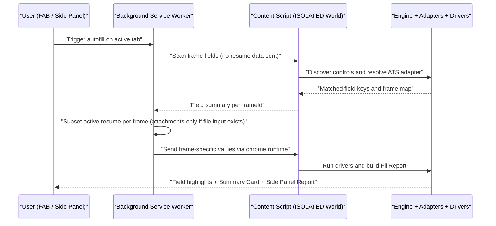
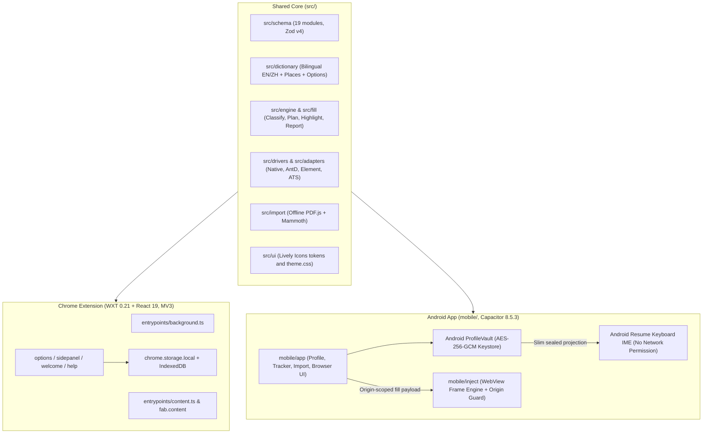

# Resume Autofill

**English** | [简体中文](README.zh-CN.md)

A local-first job application autofill tool, available as a Chrome extension (Manifest V3) and an Android app with a built-in Resume Keyboard (Capacitor). It fills application forms from your own resume without sending data to any server, covering Chinese campus-recruitment sites as well as Australian and international ATS platforms.

## Table of contents

- [Features](#features)
- [Architecture](#architecture)
- [Status and roadmap](#status-and-roadmap)
- [Supported platforms and UI stacks](#supported-platforms-and-ui-stacks)
- [Chrome extension: install and try locally](#chrome-extension-install-and-try-locally)
- [Managing resumes and local PDF/Word import](#managing-resumes-and-local-pdfword-import)
- [Android mobile app and Resume Keyboard (`mobile/`)](#android-mobile-app-and-resume-keyboard-mobile)
- [Configuration, permissions and environment variables](#configuration-permissions-and-environment-variables)
- [Development and testing](#development-and-testing)
- [Project structure](#project-structure)
- [Known limitations](#known-limitations)
- [Privacy and security](#privacy-and-security)
- [Design system](#design-system)

## Features

### Chrome extension (`entrypoints/`, `src/`)

- **One-click fill.** Click the floating button on an application page (drag it anywhere or move it with `Alt` + arrow keys; each site remembers its position). It fills the form from your active resume and leaves fields the site already prefilled untouched.
- **Never guesses.** Uncertain fields stay empty and are outlined in yellow for confirmation. Captchas, privacy-consent checkboxes, referral/employee IDs and bot traps are skipped.
- **Summary card and side panel report.** A summary card next to the button shows field counts, jumps to fields on the page, and includes an "Add them to your profile" button that opens the editor straight at the first missing input. The side panel lists all fields by severity (`filled`, `needs_review`, `no_option`, `unmatched`, `action_failed`, `no_data`, `no_control`), where you can pick a suggested candidate or edit a value directly.
- **Local PDF / `.docx` resume import.** Parses PDF (`pdfjs-dist` with locally bundled worker and CMap tables) and Word (`.docx` via `mammoth`) resumes offline. Every parsed field is shown beside its original source line in `ImportReview`, and you can save it as a new resume or merge it into an existing one with a diff preview.
- **One-click bilingual switch (`中 | EN`).** Keep separate resumes per locale (`zh-CN`, `en-AU`), optionally paired via `linkedResumeId`. Switch both the interface language and the active resume from the side panel, the options header, or the `中 / EN` tag on the floating button.
- **Cross-frame and multi-library support.** Works across nested iframes and drives native HTML, Ant Design, Element Plus, `react-select`, ARIA comboboxes and buttons, along with real ATS adapters and Chinese campus-recruitment drivers.
- **Welcome and help pages.** Includes a first-install welcome page (`entrypoints/welcome`) and an in-extension help page (`entrypoints/help`) covering fill statuses, supported sites, privacy and troubleshooting.

### Android app and Resume Keyboard (`mobile/`)

- **Encrypted local storage (`ProfileVault`).** Resumes, app state and attachments live in private app storage encrypted with AES-256-GCM under an Android Keystore key (`loggingBehavior: "none"`, system backup and device transfer disabled).
- **Built-in WebView browser.** Opens job links in an overlay WebView, injects the fill engine across frames, asks for explicit confirmation on an origin sheet before filling cross-origin frames, supports stored attachment uploads, and provides undo.
- **Link handling and application tracker.** Handles `http(s)` links and shared text, offers copied links on Home, provides launcher shortcuts, and tracks applications (company, position, status, deadline, fill counts) with local deadline alarm notifications.
- **Offline Resume Keyboard (Android IME).** A system input method in the same package. It displays a module strip, puts entries matching the current field type first, lets you switch resumes/languages, and includes basic English typing. It reads a stripped profile projection without attachments, hides resume content on password/lock-screen/no-learning fields, records nothing, and fails unit tests if bytecode references network, broadcast, service or intent APIs.

## Architecture

### Extension: per-frame data flow



### Shared core and platform isolation



## Status and roadmap

| Milestone | Scope | Status |
|---|---|---|
| **M1** | Core engine, 19-module resume editor, side panel, floating button and design system. 100% of fields are filled correctly on the synthetic test sites (native HTML, Ant Design, Element Plus). | Done |
| **M2** | Real ATS and Chinese campus-recruitment support (`Greenhouse`, `Lever`, `Workable`, `Workday`, `Ashby`, `Moka`, `Beisen`, `Feishu Recruiting`), offline snapshot capture and scoring harness, local PDF/Word resume import, one-click bilingual switch, and the Android Capacitor app (`ProfileVault`, WebView browser, application tracker and Resume Keyboard IME). Further ATS pages (`SuccessFactors`, `PageUp`, multi-step `Workday` follow-ups, etc.) are still being added. | In progress (core complete) |
| **M3** | Optional AI features: drafting answers to open-ended questions, Chinese/English resume translation, and further polish. | Planned |

## Supported platforms and UI stacks

- **ATS adapters (`src/adapters/`):** Greenhouse, Lever, Workable (multiple education and work entries), Workday. Ashby works with the general engine and ARIA/`react-select` drivers.
- **Recruitment and UI drivers (`src/drivers/`):**
  - Chinese campus-recruitment platforms: **Beisen (Phoenix)**, **Moka**, **Feishu Recruiting**.
  - UI libraries: **Native HTML** (text, select, choice, date, file, richtext), **Ant Design** (`antdSelect`, `antdPicker`), **Element Plus** (`select`, `date`, `cascader`, `upload`), **`react-select`**, and **ARIA** comboboxes, search boxes and yes/no button groups.

## Chrome extension: install and try locally

### 1. Build and load unpacked

Requires **Node.js (v22+ recommended)**, **pnpm** and **Chrome 114+** (for the `sidePanel` API).

```powershell
pnpm i
pnpm build        # output goes to .output/chrome-mv3
```

Load it into Chrome:
1. Open `chrome://extensions`.
2. Turn on **Developer mode** at the top right.
3. Click **Load unpacked** and select `.output/chrome-mv3`.
4. After another `pnpm build`, click the reload icon on the extension card to update.

On first install, the extension opens the welcome page and seeds two sample resumes: `林知远（中文简历）` (`zh-CN`) and `Zhiyuan (Leo) Lin (English resume)` (`en-AU`).

### 2. Try on synthetic test sites

The repository includes synthetic application pages covering the three main UI stacks:

```powershell
pnpm fixtures:build
pnpm fixtures:preview     # serves on fixed port 4173
```

Open <http://localhost:4173/> and pick a page:

| Page | Path | Sample resume |
|---|---|---|
| Native HTML (`en-AU`) | `/native/` (with iframe at `/native/frame.html`) | `Zhiyuan (Leo) Lin` |
| Ant Design (`zh-CN`) | `/antd/` | `林知远` |
| Element Plus (`zh-CN`) | `/element/` | `林知远` |

Steps:
1. Open the side panel from the toolbar icon and choose the matching resume (or use the `中 | EN` switch).
2. Click the floating button on the test page (it first shows the number of detected fields).
3. Check the border colors:
   - **Green (2px solid):** filled.
   - **Yellow (2px dashed):** needs review (multiple candidates or no matching option); stays empty.
   - **Red (3px solid):** unrecognized or fill failed.
   - **No border:** no data in your resume (or an intentional trap such as a captcha, privacy checkbox or referee employee ID).
4. Use the summary card to locate fields on the page, or click **"Add them to your profile"** to open the editor at the first missing field.
5. Check the side panel for the full report sorted by severity, candidate adoption, inline editing and direct jumps to missing fields.

## Managing resumes and local PDF/Word import

Open the **Options / Profile** page from `chrome://extensions`, the side panel toolbar or the summary card:

- **Resume library:** Create (pick `zh-CN` or `en-AU`), duplicate, pair bilingual resumes (`linkedResumeId`), delete and set active.
- **19-module editor (`src/editor/modules.ts`):**
  - *Single-object and root modules:* `basics` (including native place, household, student origin and current location), `contact`, `workRights`, `jobIntention`, `emergencyContact`, `diversity`, `about` (`selfIntroduction`, `hobbies`).
  - *Repeatable array modules:* `education`, `work`, `projects`, `campus`, `awards`, `languages`, `certificates`, `skills`, `family`, `referees`, `customAnswers`.
  - Changes autosave and invalid values (such as date formats `YYYY-MM` / `YYYY-MM-DD`) are flagged in place.
- **Local resume import (`src/import/`):** Upload a `.pdf` or `.docx` resume (up to 10 MB). `pdfjs-dist` and `mammoth` parse it offline on your machine, show each recognized value next to its source line in `ImportReview`, and let you create a new resume or merge into an existing one.
- **Attachments (`attachments`):** Store Resume PDF, ID photo and transcript in IndexedDB (up to 10 MB per file).
- **JSON backup:** Export all resumes and settings as JSON. Importing replaces existing profile data after confirmation (attachments are not included in JSON).
- **Settings:** Interface language (`auto` / `zh` / `en`), reset saved floating button positions per site, and the `previewBeforeFill` preference switch.

## Android mobile app and Resume Keyboard (`mobile/`)

The `mobile/` workspace wraps the shared schema, editor logic, bilingual dictionaries, fill engine and local resume importer into a native Android app with **Capacitor 8.5.3**.

### Capabilities

- **Home and onboarding:** Paste or tap a recently copied job link, check recent applications and closing-soon reminders, and switch the active resume.
- **Profile and attachments:** Full 19-module mobile editor with bottom-sheet pickers, tag chips, system date/month pickers, autosave (`500 ms` and on background), and encrypted file storage (`files/attachments`).
- **Built-in WebView browser:** Injects `mobile/inject` into frames, shows a floating fill button with report and undo, uploads attachments from `ProfileVault`, and guards cross-origin frames with an origin confirmation sheet.
- **Application tracker and deep links:** Handles shared text or `http(s)` links, tracks status, deadlines and fill counts, and schedules local alarm notifications.
- **Resume Keyboard IME:** Enabled in Android settings through the in-app setup flow. Provides a module strip, context-prioritized entry chips, resume/language switching and basic English typing without network access.

### Mobile commands

Run inside `mobile/`:

```powershell
cd mobile
npm install
npm run dev           # Vite dev server for mobile UI
npm run build         # Check native theme tokens, build app and WebView inject bundle, copy page assets
npm run build:inject  # Rebuild WebView injection bundle only
npm run sync          # Build and run cap sync android
```

To build the Android debug APK and run device E2E tests (from the repo root):

```powershell
# Inside mobile/android: ./gradlew assembleDebug (or gradlew.bat assembleDebug on Windows)
$env:RAF_SERIAL="<adb-device-serial>"
npx playwright test --config mobile/e2e/playwright.config.ts
```

## Configuration, permissions and environment variables

This project requires no external API keys, backend servers or `.env` files.

### Extension manifest permissions (`wxt.config.ts`)

| Permission / Setting | Purpose |
|---|---|
| `storage`, `unlimitedStorage` | Store resume profiles, settings and local data in `chrome.storage.local` and IndexedDB |
| `sidePanel` | Render the side panel report and resume switcher (Chrome 114+) |
| `webNavigation` | List frames in the active tab so data is sent per frame (`tabs` permission is not requested) |
| `<all_urls>` (host permission) | Recognize and fill job application forms across recruitment sites |
| `content_security_policy` | `default-src 'self'; script-src 'self'; object-src 'self'; connect-src 'self'; form-action 'none'; frame-src 'none'` on extension pages |

### Runtime and test environment variables

| Variable | Scope | Description |
|---|---|---|
| `RAF_SERIAL` | `mobile/e2e` | Target ADB device/emulator serial for Playwright Android WebView E2E tests |
| `RAF_ALLOW_WIPE` | `mobile/e2e` | Must be set to `1` before `mobile/e2e/profile.device.spec.ts` runs on a physical phone |

## Development and testing

| Command | Purpose |
|---|---|
| `pnpm dev` | Start WXT development mode |
| `pnpm build` | Build the extension to `.output/chrome-mv3` |
| `pnpm zip` | Package the extension with WXT |
| `pnpm typecheck` | Run `wxt prepare` and `tsc --noEmit` for the extension and synthetic fixtures |
| `pnpm test` | Run unit tests (Vitest + jsdom) |
| `pnpm test:watch` | Run unit tests in watch mode |
| `pnpm harness:build` | Build the in-page driver test harness |
| `pnpm test:drivers` | Build harness and run Playwright control-driver and whole-page accuracy tests |
| `pnpm e2e` | Build extension and run headless Playwright E2E across synthetic sites |
| `pnpm e2e:headed` | Run Playwright E2E with a visible Chromium window |
| `pnpm visual` | Build extension and run light/dark visual screenshot tests (`tests/visual`) |
| `pnpm fixtures:dev` | Start Vite dev server for synthetic sites |
| `pnpm fixtures:build` | Build synthetic test sites |
| `pnpm fixtures:preview` | Preview synthetic sites on fixed port `4173` |
| `pnpm capture` | Run `scripts/capture-page.ts` to capture sanitized snapshots of real application pages |
| `pnpm test:captured` | Build harness and extension, then run Playwright tests on captured snapshots |
| `pnpm accuracy:table` | Generate accuracy summary table (`scripts/accuracy-table.ts`) |
| `pnpm live-check` | Build extension and run guarded live-site verification (`scripts/live-check.ts`) |

## Project structure

| Path | Contents |
|---|---|
| `entrypoints/` | Extension entry points: `background.ts`, `content.ts`, `fab.content/`, `options/`, `sidepanel/`, `welcome/`, `help/` |
| `src/adapters/` | Site-specific ATS adapters (`greenhouse.ts`, `lever.ts`, `workable.ts`, `workday.ts`, `resolve.ts`) |
| `src/background/` | Message routing, frame discovery, per-frame data subsetting, sample resume seeding |
| `src/content/` | Per-frame content-script handlers and DOM listeners |
| `src/dictionary/` | Bilingual field, option, section, place, add-button and similarity dictionaries |
| `src/drivers/` | UI and platform drivers (`native/`, `element/`, `workday/`, `antd*.ts`, `beisen.ts`, `moka.ts`, `feishu.ts`, `aria.ts`, `searchBox.ts`) |
| `src/editor/` | Pure module definitions (19 modules), mutations, validation, field jump targets, import/export |
| `src/engine/` | Field discovery, classification, visibility, grouping, field dependencies, date formatting and fill planning |
| `src/fill/` | Fill runner, card creation (`ensureCards.ts`), highlights and report generation |
| `src/import/` | Offline PDF (`pdfjs-dist`) and `.docx` (`mammoth`) extraction and resume draft parsing |
| `src/messaging/`, `src/i18n/` | Typed `chrome.runtime` message protocol and bilingual UI strings |
| `src/schema/` | Zod v4 resume model, field keys, migrations and neutral sample data |
| `src/storage/` | `chrome.storage.local` and IndexedDB persistence for profiles and attachments |
| `src/ui/` | Shared "Lively Icons" design tokens, themes, bundled fonts, Bootstrap Icons registry and status mapping |
| `mobile/` | Capacitor 8.5.3 Android app (`app/`, `android/`, `bridge/`, `inject/`, `demo/`, `e2e/`, `scripts/`) |
| `fixtures/` | Synthetic test sites (`synthetic/`) and generated sample resume PDFs (`resume-samples/`) |
| `scripts/` | Icon renderer (`render-icons.mjs`), sample generator, page capture, accuracy table and live check |
| `tests/` | `unit/`, `drivers/`, `e2e/`, `captured/`, `visual/` and `shared/` test suites |

## Known limitations

- **Date range pickers:** Single-control date range pickers (start and end in one input) are not supported yet; single-date and year-month pickers are.
- **No AI layer yet:** Field recognition relies on dictionaries, rules and adapters. Unrecognized custom employer questions stay empty and are marked red.
- **No pre-fill preview modal:** Clicking the floating button fills directly and relies on the summary card, side panel and mobile undo for review (the `previewBeforeFill` setting is stored for future use).
- **Dynamic "Add entry" buttons:** Extra education/work cards are created by matching known "Add ..." button text. If a module has no add button or its text is unrecognized, extra resume entries are skipped.
- **Gender / diversity defaults:** Gender questions with a decline option default to "Prefer not to say" unless changed in the **Diversity** section of the editor.
- **More ATS platforms:** Multi-step Workday follow-up pages, SuccessFactors, PageUp and other ATS platforms are still being added under M2.

## Privacy and security

- **Local persistence:** Extension data stays in `chrome.storage.local` and IndexedDB. Mobile data stays in Android private storage encrypted with AES-256-GCM (`ProfileVault` under Android Keystore, with backup and device transfer disabled).
- **No network requests:** Extension pages enforce a strict CSP (`default-src 'self'; connect-src 'self'; form-action 'none'; frame-src 'none'`). `pdfjs-dist` (worker and CMaps) and `@fontsource/*` fonts are bundled locally; there is no `fetch`, `XMLHttpRequest`, `WebSocket` or analytics in the extension.
- **ISOLATED world and channel isolation:** Content scripts run in the default `ISOLATED` world. Resume data never passes through `window.postMessage` (WXT's content-script-started announcement is disabled), and components communicate only over `chrome.runtime`.
- **Per-frame and per-origin minimization:** The background queries recognized field keys first without sending resume values, then sends each frame only matching values (attachments go only to frames with file inputs). On mobile WebView, cross-origin frames require explicit user confirmation on an origin sheet first.
- **Keyboard IME isolation:** The Android Resume Keyboard reads a stripped projection without attachments, hides resume content on password/lock-screen/no-learning fields, logs nothing, and fails unit tests if bytecode references network, broadcast, service or intent APIs.

## Design system

All extension surfaces (options page, side panel, welcome/help and floating button) and the mobile app share the **"Lively Icons"** design system: quiet screens, icon first, `paper` / `surface` / `tile` layers separated by 1px borders, and no drop shadows. The core files live in `src/ui/`:

| File (`src/ui/`) | Contents |
|---|---|
| `tokens.ts`, `theme.css` | Design tokens (`--raf-*` CSS custom properties) |
| `fonts.css` | Bundled web fonts for extension pages |
| `Icon.tsx` | Inline SVG icons registered from `bootstrap-icons` |
| `status.ts` | Tone, icon and label mapping (`OUTCOME_STATUS`) |

- **Tokens:** Edit `tokens.ts` and `theme.css` together (`tests/unit/ui/tokens.test.ts` checks light/dark parity and forbids hard-coded colors; `mobile/scripts/gen-native-theme.mjs --check` keeps mobile native tokens in sync). Weights are `400` and `600`, shadows are `none`, and motion timings are `320 ms` spring (`--raf-motion-move`), `160 ms` (`--raf-motion-settle`) and `120 ms` (`--raf-motion-duration`).
- **Dark mode:** Follows the system `prefers-color-scheme` setting with no manual toggle; dark mode uses no hue outside semantic status colors.
- **Fonts:** Extension pages bundle `Manrope` (`400`, `600`) and `ZCOOL KuaiLe` (display titles) via `@fontsource/*`; the mobile app bundles `Lexend`, `Shantell Sans` and `ZCOOL KuaiLe`. The Shadow DOM floating button falls back to the system font stack (`Noto Sans SC`, `PingFang SC`, `Microsoft YaHei`, `system-ui`).
- **Status and page highlights:** Status icons always appear next to a label (`OUTCOME_STATUS`). Page field outlines use `HIGHLIGHT_COLORS` in `tokens.ts` with different border styles: `2px solid` (filled), `2px dashed` (needs review) and `3px solid` (failed).
- **Extension icons:** `public/icon/{16,32,48,128}.png` are rendered from the design system (`#0066cc` accent tile + `file-earmark-check`) with `node scripts/render-icons.mjs`.
