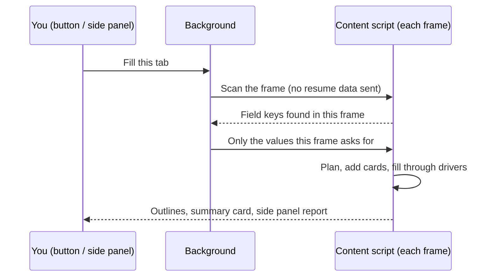

<div align="center">

# Resume Autofill

**Fill job applications from your own resume in one click, with your data kept on your device.**

[](https://github.com/LewisSwan24/resume-autofill/actions/workflows/mobile-build.yml)


[](README.md) [](README.zh-CN.md)

[Wiki](https://github.com/LewisSwan24/resume-autofill/wiki) · [中文 Wiki](https://github.com/LewisSwan24/resume-autofill/wiki/%E9%A6%96%E9%A1%B5)

</div>

Resume Autofill is a Chrome extension and an Android app. Open an application page, press the floating button, and the form is filled from the resume you keep in the extension. It works on Chinese campus-recruitment portals (Moka, Feishu, Beisen) and on international applicant tracking systems (Workday, Greenhouse, Lever, Ashby and more). No account, no server and no API key: resumes live in the browser or in the phone's encrypted storage.

When it is not sure, it leaves the field empty and asks rather than guessing.

## Contents

- [Highlights](#highlights)
- [Supported sites](#supported-sites)
- [Quick start](#quick-start)
- [Android app](#android-app)
- [How it works](#how-it-works)
- [Privacy](#privacy)
- [Development](#development)
- [Project layout](#project-layout)
- [Limitations](#limitations)
- [Documentation](#documentation)

## Highlights

| | |
|---|---|
| **One-click fill** | A draggable button on the page fills every frame of the form, adds education, work and project cards as needed, and uploads your resume, photo, transcript or portfolio file to the matching upload boxes. |
| **Never guesses** | A field it cannot match with confidence stays empty and is outlined for review. Captchas, consent boxes, referral IDs and bot traps are left alone. |
| **Keeps your answers** | On a form that opens already filled from an earlier application, it keeps what you wrote and shows the resume's value beside it to compare. Names and contact details the site brought in by itself are replaced. |
| **Report** | A summary card and a side panel list every field as filled, needs review, no option, unmatched, failed, no data or no control. Jump to any field, pick a suggested answer or edit it in place. |
| **Preview and multi-page forms** | Optionally review and untick values before they are written. On a form split over several pages it can press the page's own Next button, filling each step, and it always stops before the final submit. |
| **Two languages** | Keep a Chinese and an English resume side by side, paired, and switch both the resume and the interface with one `中 / EN` toggle. |
| **Local import** | Read a PDF or Word resume on your machine and review each value next to the line it came from before saving. |
| **Sensitive fields** | Identity numbers are left for you to type unless you choose otherwise in settings. |
| **More tools** | Resume variants, an encrypted vault, device-to-device sync over your local network, an application tracker, templates, a resume health check and site recipes for custom questions. Optional writing help uses Chrome's built-in AI or a local Ollama on your own machine. |

## Supported sites

| Kind | Sites | How it is handled |
|---|---|---|
| Chinese campus portals | **Moka** (desktop and phone), **Feishu Recruiting** (both form generations, desktop and phone), **Beisen** | Platform drivers for their lists, place trees, school searches, date wheels and month spans |
| Company sites | ByteDance, Nowcoder, Tencent | Portal adapter |
| Applicant tracking systems | **Workday**, **Greenhouse**, **Lever**, **Workable**, **Ashby**, **Rippling**, PageUp, SmartRecruiters, SuccessFactors | Site adapters on top of the general engine |
| Everything else | Native HTML, Ant Design, Element Plus, `react-select`, ARIA comboboxes and button groups, Shadow DOM | The general engine and UI-library drivers |

Recorded pages from Moka, Feishu, Beisen, Workday, Greenhouse, Lever, Workable, Ashby, Rippling, Breezy, Gem, Manatal, Pinpoint, Recruitee, Teamtailor and Zoho are replayed offline and scored field by field, with zero wrong fills as the target. The recordings stay on the developer's machine and are not part of the repository.

## Quick start

You need **Node.js 22+**, **pnpm** and **Chrome 114+**.

```powershell
pnpm i
pnpm build
```

1. Open `chrome://extensions` and turn on **Developer mode**.
2. Click **Load unpacked** and pick `.output/chrome-mv3`.
3. The welcome page opens with two fictional sample resumes, one Chinese and one English. Replace them with your own in the extension's options page, or import a PDF or Word file.
4. Open an application page, choose the resume in the side panel, and press the floating button.

Outlines on the page show what happened:

| Outline | Meaning |
|---|---|
| Green, solid | Filled |
| Yellow, dashed | Needs review: several candidates, no matching option, or your own earlier answer kept |
| Red, solid | Not recognised, or the fill failed |
| None | Nothing in your resume for it, or a field left alone on purpose |

To try it without visiting a real site, run the synthetic test pages:

```powershell
pnpm fixtures:build
pnpm fixtures:preview   # http://localhost:4173: /native/, /antd/, /element/
```

## Android app

The app in [`mobile/`](mobile) brings the same fill engine to the phone (Capacitor 8, Android 10 and later).

- **Fill browser.** Open a job link, tap fill, review the report, undo if needed. A form embedded from another site gets your data only after you approve that site by name.
- **Resume keyboard.** A system keyboard that types resume entries anywhere the browser cannot reach, such as WeChat mini programs. It never goes online.
- **Tracker.** Applications with status, deadlines and local reminders.
- **Encrypted storage.** Resumes and files are sealed with AES-256-GCM under an Android Keystore key and excluded from backups.

Build steps, flavors and device tests are in the [Android app](https://github.com/LewisSwan24/resume-autofill/wiki/Android-App) wiki page.

## How it works



Each frame is scanned first and gets only the values its own fields need; files go only to frames with an upload box. Matching is done with bilingual dictionaries, section context and site adapters, never with a remote model. More in [Architecture](https://github.com/LewisSwan24/resume-autofill/wiki/Architecture).

## Privacy

- Extension data stays in `chrome.storage.local` and IndexedDB. The phone app keeps it in encrypted private storage.
- Extension pages run under a strict CSP. The only address they may call is a local Ollama on `127.0.0.1:11434`, and only if you turn that on. There is no analytics and no remote fetch.
- Content scripts run in Chrome's isolated world and talk only over `chrome.runtime`; resume data never crosses `window.postMessage`.
- Sync between devices goes directly over your local network with no relay server, and the stream is encrypted before it leaves.

Details: [Privacy and security](https://github.com/LewisSwan24/resume-autofill/wiki/Privacy-and-Security).

## Development

| Command | What it does |
|---|---|
| `pnpm dev` | WXT development mode |
| `pnpm build` / `pnpm zip` | Build to `.output/chrome-mv3` / package it |
| `pnpm typecheck` | `wxt prepare` and `tsc` for the extension and test sites |
| `pnpm test` | Unit tests (Vitest, jsdom) |
| `pnpm test:drivers` | Driver and whole-page tests in Playwright |
| `pnpm e2e` / `pnpm visual` | End-to-end runs on the test sites / light and dark screenshots |
| `pnpm capture` | Record a real application page for offline replay (no filling, no clicks) |
| `pnpm test:captured` | Replay recorded pages and score each field |
| `pnpm live-check` | One guarded run on a live page with the fictional resume and all writes blocked |

How recordings, expectations and scoring fit together is in [Development](https://github.com/LewisSwan24/resume-autofill/wiki/Development).

## Project layout

| Path | Contents |
|---|---|
| `entrypoints/` | Background, content script, floating button, options, side panel, welcome and help pages |
| `src/engine/`, `src/fill/` | Scan, classify, group, plan, fill, highlight and report |
| `src/drivers/`, `src/adapters/` | UI-library and platform drivers; per-site adapters |
| `src/dictionary/` | Bilingual field, option, section and place dictionaries |
| `src/schema/`, `src/editor/` | The resume model (19 modules) and the editor's logic |
| `src/import/` | Offline PDF and Word reading |
| `src/storage/`, `src/sync/` | Local storage, the vault, local-network sync |
| `src/ai/`, `src/tailor/`, `src/audit/`, `src/templates/`, `src/recipes/`, `src/tracker/` | Optional on-device helpers |
| `src/ui/` | Design tokens, theme, fonts and icons |
| `mobile/` | The Android app, its native code, the page bundle and device tests |
| `fixtures/synthetic/` | Test sites for the three main UI stacks |
| `scripts/`, `tests/` | Capture, live check, accuracy table; unit, driver, e2e, captured and visual tests |

## Limitations

- Fields are matched with dictionaries and rules. A company's own unusual question stays empty and is marked for you.
- A site's school or company search needs the live site; offline replays answer only the searches that were recorded.
- Extra cards are added through each section's own add button. A section without a recognisable one gets only the cards already on the page.
- There is no iOS app. Sites that allow only WeChat login cannot be signed into inside the Android app's browser; use the resume keyboard there.

## Documentation

The [wiki](https://github.com/LewisSwan24/resume-autofill/wiki) covers [getting started](https://github.com/LewisSwan24/resume-autofill/wiki/Getting-Started), [the fill report](https://github.com/LewisSwan24/resume-autofill/wiki/Fill-Report), [your resume data](https://github.com/LewisSwan24/resume-autofill/wiki/Resume-Data), [supported sites](https://github.com/LewisSwan24/resume-autofill/wiki/Supported-Sites), [the Android app](https://github.com/LewisSwan24/resume-autofill/wiki/Android-App), [local AI](https://github.com/LewisSwan24/resume-autofill/wiki/Local-AI), [privacy](https://github.com/LewisSwan24/resume-autofill/wiki/Privacy-and-Security), [architecture](https://github.com/LewisSwan24/resume-autofill/wiki/Architecture), [development](https://github.com/LewisSwan24/resume-autofill/wiki/Development) and a [FAQ](https://github.com/LewisSwan24/resume-autofill/wiki/FAQ).
