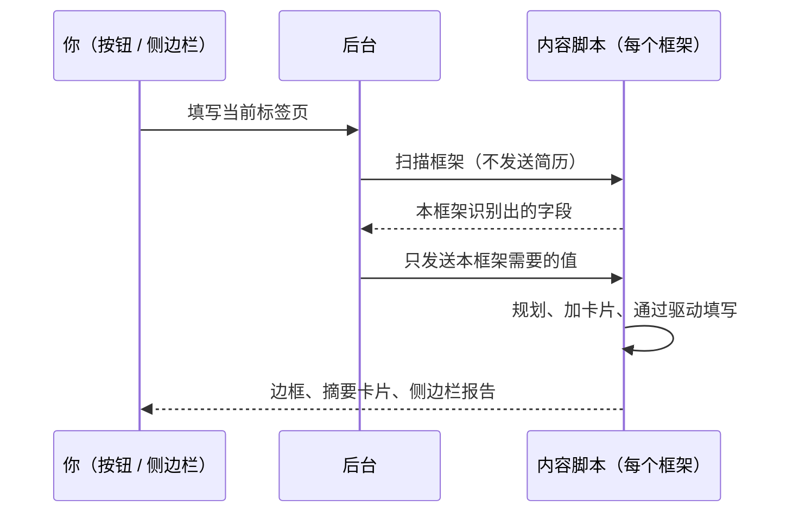

<div align="center">

# Resume Autofill · 网申简历一键填写

**用你自己的简历，一键填好网申表单；资料只存在你自己的设备上。**

[](https://github.com/LewisSwan24/resume-autofill/actions/workflows/mobile-build.yml)


[](README.md) [](README.zh-CN.md)

[中文 Wiki](https://github.com/LewisSwan24/resume-autofill/wiki/%E9%A6%96%E9%A1%B5) · [English Wiki](https://github.com/LewisSwan24/resume-autofill/wiki)

</div>

Resume Autofill 包括一个 Chrome 扩展和一个安卓应用。打开网申页面，点页面上的悬浮按钮，表单就会按你存在扩展里的简历填好。国内校招平台（Moka、飞书招聘、北森）和海外招聘系统（Workday、Greenhouse、Lever、Ashby 等）都能用。不需要注册账号，没有服务器，也不用 API 密钥：简历存在浏览器里，或者手机的加密存储里。

拿不准的字段，它会留空并提醒你确认，不会乱猜。

## 目录

- [主要功能](#主要功能)
- [支持的网站](#支持的网站)
- [快速上手](#快速上手)
- [安卓应用](#安卓应用)
- [工作原理](#工作原理)
- [隐私](#隐私)
- [开发](#开发)
- [目录结构](#目录结构)
- [已知限制](#已知限制)
- [文档](#文档)

## 主要功能

| | |
|---|---|
| **一键填写** | 页面上的按钮可以拖动。点一下，表单的每个框架都会填好；教育、工作、项目经历不够时会自动添加卡片；简历、证件照、成绩单、作品集文件会传到对应的上传框。 |
| **不乱猜** | 没把握的字段留空，并加框提示你确认。验证码、隐私同意、内推码和防机器人陷阱一律不碰。 |
| **保留你填过的答案** | 有些表单会带出你上次投递时填的内容。这时你自己的答案保留不动，简历里的值放在旁边供你对比。网站自己带出的姓名、联系方式等，以简历为准。 |
| **填写报告** | 摘要卡片和侧边栏会列出每个字段的结果：已填写、待确认、无匹配选项、未识别、填写失败、简历无此项、页面无控件。可以跳到对应字段、采用推荐答案或直接修改。 |
| **填写前预览、多页表单** | 可以先预览、取消勾选再写入。分好几页的表单，它会点页面自己的“下一步”逐页填写，并且一定停在最终提交之前。 |
| **中英双语** | 中文简历和英文简历可以配对保存。一个 `中 / EN` 开关同时切换简历和界面语言。 |
| **本地导入** | 在你自己的电脑上读取 PDF 或 Word 简历，每个值都和原文那一行并排显示，确认后再保存。 |
| **敏感信息** | 身份证号等证件号码默认留给你自己填，可以在设置里改。 |
| **其他工具** | 多版本简历、加密保险库、局域网设备间同步、网申记录、模板、简历体检、自定义问题的站点规则。写作辅助可选，用 Chrome 内置 AI 或你本机的 Ollama。 |

## 支持的网站

| 类别 | 网站 | 处理方式 |
|---|---|---|
| 国内校招平台 | **Moka**（电脑和手机）、**飞书招聘**（两代表单，电脑和手机）、**北森** | 平台驱动：下拉列表、地点树、学校搜索、日期滚轮、起止月份 |
| 企业自建站 | 字节跳动、牛客、腾讯 | 门户适配器 |
| 海外招聘系统 | **Workday**、**Greenhouse**、**Lever**、**Workable**、**Ashby**、**Rippling**、PageUp、SmartRecruiters、SuccessFactors | 站点适配器加通用引擎 |
| 其他网站 | 原生 HTML、Ant Design、Element Plus、`react-select`、ARIA 下拉框和按钮组、Shadow DOM | 通用引擎和组件库驱动 |

Moka、飞书、北森、Workday、Greenhouse、Lever、Workable、Ashby、Rippling、Breezy、Gem、Manatal、Pinpoint、Recruitee、Teamtailor、Zoho 的真实页面都录制下来离线回放，逐字段打分，目标是填错为零。录制文件只保存在开发者本机，不在仓库里。

## 快速上手

需要 **Node.js 22+**、**pnpm** 和 **Chrome 114+**。

```powershell
pnpm i
pnpm build
```

1. 打开 `chrome://extensions`，开启右上角的 **开发者模式**。
2. 点 **加载已解压的扩展程序**，选择 `.output/chrome-mv3`。
3. 欢迎页会打开，并预置两份虚构的示例简历（中文、英文各一份）。在扩展的设置页换成你自己的，或者导入 PDF / Word 文件。
4. 打开网申页面，在侧边栏选好简历，点悬浮按钮。

页面上的边框表示结果：

| 边框 | 含义 |
|---|---|
| 绿色实线 | 已填写 |
| 黄色虚线 | 待确认：有多个候选、没有匹配的选项，或者保留了你之前的答案 |
| 红色实线 | 没识别出来，或填写失败 |
| 无边框 | 简历里没有这项，或者故意不填的字段 |

不想访问真实网站，也可以用仓库自带的测试页试：

```powershell
pnpm fixtures:build
pnpm fixtures:preview   # http://localhost:4173：/native/、/antd/、/element/
```

## 安卓应用

[`mobile/`](mobile) 里的应用把同一套填写引擎搬到了手机上（Capacitor 8，Android 10 及以上）。

- **填写浏览器**：打开职位链接，点填写，看报告，不满意可以撤销。页面里嵌的其他网站的表单，要你按名字同意后才会拿到资料。
- **简历输入法**：一个系统键盘，在浏览器进不去的地方（比如微信小程序）也能输入简历内容。它从不联网。
- **网申记录**：记录投递状态和截止日期，到期前本地提醒。
- **加密存储**：简历和文件用 Android Keystore 里的密钥做 AES-256-GCM 加密，不进系统备份。

构建方法、版本区别和真机测试见 Wiki 的 [安卓应用](https://github.com/LewisSwan24/resume-autofill/wiki/%E5%AE%89%E5%8D%93%E5%BA%94%E7%94%A8) 页。

## 工作原理



每个框架先扫描，只拿到自己字段需要的值；文件只发给有上传框的框架。字段匹配靠双语词典、所在区块和站点适配器，不用远程模型。详见 [架构](https://github.com/LewisSwan24/resume-autofill/wiki/%E6%9E%B6%E6%9E%84)。

## 隐私

- 扩展的数据存在 `chrome.storage.local` 和 IndexedDB 里，手机应用的数据存在加密的私有存储里。
- 扩展页面有严格的 CSP。唯一允许访问的地址是本机 `127.0.0.1:11434` 上的 Ollama，而且要你自己开启。没有统计，也不请求任何远程地址。
- 内容脚本运行在 Chrome 的隔离环境里，只通过 `chrome.runtime` 通信，简历数据从不经过 `window.postMessage`。
- 设备间同步直接走局域网，不经过中转服务器，数据离开设备前已经加密。

详见 [隐私与安全](https://github.com/LewisSwan24/resume-autofill/wiki/%E9%9A%90%E7%A7%81%E4%B8%8E%E5%AE%89%E5%85%A8)。

## 开发

| 命令 | 作用 |
|---|---|
| `pnpm dev` | WXT 开发模式 |
| `pnpm build` / `pnpm zip` | 构建到 `.output/chrome-mv3` / 打包 |
| `pnpm typecheck` | `wxt prepare` 加扩展和测试站的 `tsc` |
| `pnpm test` | 单元测试（Vitest、jsdom） |
| `pnpm test:drivers` | Playwright 驱动测试和整页测试 |
| `pnpm e2e` / `pnpm visual` | 测试站端到端 / 明暗两套截图 |
| `pnpm capture` | 录制真实网申页面供离线回放（不填写、不点击） |
| `pnpm test:captured` | 回放录制的页面，逐字段打分 |
| `pnpm live-check` | 在真实页面上用虚构简历跑一次，所有写入都被拦下 |

录制、期望值和打分怎么配合，见 [开发](https://github.com/LewisSwan24/resume-autofill/wiki/%E5%BC%80%E5%8F%91)。

## 目录结构

| 路径 | 内容 |
|---|---|
| `entrypoints/` | 后台、内容脚本、悬浮按钮、设置页、侧边栏、欢迎页和帮助页 |
| `src/engine/`、`src/fill/` | 扫描、识别、分组、规划、填写、标记和报告 |
| `src/drivers/`、`src/adapters/` | 组件库和平台驱动；各站点适配器 |
| `src/dictionary/` | 双语的字段、选项、区块和地名词典 |
| `src/schema/`、`src/editor/` | 简历模型（19 个模块）和编辑器逻辑 |
| `src/import/` | 离线读取 PDF 和 Word |
| `src/storage/`、`src/sync/` | 本地存储、保险库、局域网同步 |
| `src/ai/`、`src/tailor/`、`src/audit/`、`src/templates/`、`src/recipes/`、`src/tracker/` | 可选的本机辅助功能 |
| `src/ui/` | 设计令牌、主题、字体和图标 |
| `mobile/` | 安卓应用、原生代码、页面注入包和真机测试 |
| `fixtures/synthetic/` | 三种主流组件库的测试站 |
| `scripts/`、`tests/` | 录制、实网检查、准确率表；单元、驱动、端到端、回放和截图测试 |

## 已知限制

- 字段靠词典和规则匹配。公司自己出的特殊问题会留空，并标出来给你填。
- 网站的学校或公司搜索需要连到真实网站；离线回放只能回答录制过的搜索。
- 额外的经历卡片靠各区块自己的“添加”按钮。找不到这个按钮的区块，只会填页面上已有的卡片。
- 还没有 iOS 应用。只允许微信登录的网站，在安卓应用的浏览器里登不上，可以改用简历输入法。

## 文档

[Wiki](https://github.com/LewisSwan24/resume-autofill/wiki/%E9%A6%96%E9%A1%B5) 里有：[安装与上手](https://github.com/LewisSwan24/resume-autofill/wiki/%E5%AE%89%E8%A3%85%E4%B8%8E%E4%B8%8A%E6%89%8B)、[填写报告](https://github.com/LewisSwan24/resume-autofill/wiki/%E5%A1%AB%E5%86%99%E6%8A%A5%E5%91%8A)、[简历资料](https://github.com/LewisSwan24/resume-autofill/wiki/%E7%AE%80%E5%8E%86%E8%B5%84%E6%96%99)、[支持的网站](https://github.com/LewisSwan24/resume-autofill/wiki/%E6%94%AF%E6%8C%81%E7%9A%84%E7%BD%91%E7%AB%99)、[安卓应用](https://github.com/LewisSwan24/resume-autofill/wiki/%E5%AE%89%E5%8D%93%E5%BA%94%E7%94%A8)、[本机 AI](https://github.com/LewisSwan24/resume-autofill/wiki/%E6%9C%AC%E6%9C%BAAI)、[隐私与安全](https://github.com/LewisSwan24/resume-autofill/wiki/%E9%9A%90%E7%A7%81%E4%B8%8E%E5%AE%89%E5%85%A8)、[架构](https://github.com/LewisSwan24/resume-autofill/wiki/%E6%9E%B6%E6%9E%84)、[开发](https://github.com/LewisSwan24/resume-autofill/wiki/%E5%BC%80%E5%8F%91) 和 [常见问题](https://github.com/LewisSwan24/resume-autofill/wiki/%E5%B8%B8%E8%A7%81%E9%97%AE%E9%A2%98)。
