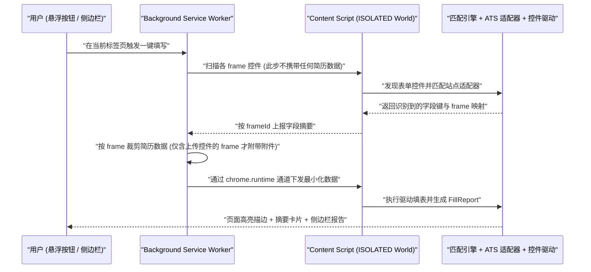
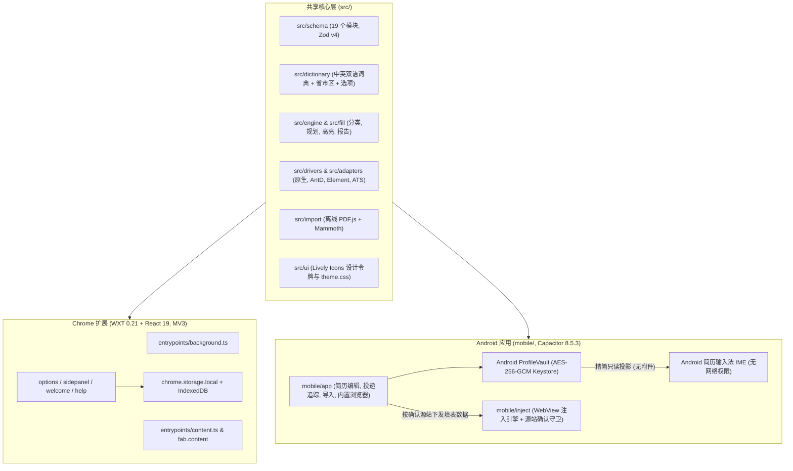

# Resume Autofill（网申简历一键填写助手）

[English](README.md) | **简体中文**

本地优先的网申简历一键填写工具，包含 Chrome 浏览器扩展（Manifest V3）和配套 Android 应用及简历输入法（Capacitor）。它不需要把简历上传到任何服务器，直接按你本地保存的简历填写招聘表单，覆盖国内校招平台和澳洲、海外主流 ATS 平台。

## 目录

- [核心特性](#核心特性)
- [系统架构](#系统架构)
- [当前状态与路线图](#当前状态与路线图)
- [支持平台与组件库](#支持平台与组件库)
- [Chrome 扩展：安装与本地试用](#chrome-扩展安装与本地试用)
- [管理简历与本地 PDF / Word 导入](#管理简历与本地-pdf--word-导入)
- [Android 移动端应用与简历键盘（`mobile/`）](#android-移动端应用与简历键盘mobile)
- [配置、权限与环境变量](#配置权限与环境变量)
- [开发与测试命令](#开发与测试命令)
- [项目结构](#项目结构)
- [已知限制](#已知限制)
- [隐私与安全](#隐私与安全)
- [设计系统](#设计系统)

## 核心特性

### Chrome 扩展（`entrypoints/`、`src/`）

- **一键填写与保留预填。** 点击网申页面上的悬浮按钮（支持鼠标拖拽或 `Alt` + 方向键微调，各站点会记住自己的位置），按当前选中简历填表，页面上已经预填好的字段会保留不动。
- **绝不瞎填。** 没把握的字段保持留空，并用黄色虚线标出待确认；验证码、隐私同意勾选框、推荐人工号和防爬虫陷阱字段都会跳过。
- **页内摘要卡片与侧边栏报告。** 按钮旁会弹出摘要卡片，可直接在页面上定位字段，也提供「添加到我的资料」按钮一键跳到简历编辑器里第一个缺数据的输入框。侧边栏按严重程度（`filled`、`needs_review`、`no_option`、`unmatched`、`action_failed`、`no_data`、`no_control`）列出完整报告，支持采纳候选项或行内手动修改。
- **本地 PDF / `.docx` 简历导入。** 用本地打包的 `pdfjs-dist`（含本地 worker 和 CMap 字体表）与 `mammoth` 离线解析简历，并在 `ImportReview` 里把每个字段和原文逐行对照展示，确认后可新建简历或对比差异后合并到已有简历。
- **中英一键切换（`中 | EN`）。** 支持按语言维护多份简历（`zh-CN`、`en-AU`），并可用 `linkedResumeId` 配对关联；在侧边栏、选项页顶栏或悬浮按钮的 `中 / EN` 标签都能直接切换界面语言和对应简历。
- **跨 iframe 与多组件库驱动。** 支持嵌套 iframe，能驱动原生 HTML、Ant Design、Element Plus、`react-select`、ARIA 下拉框与按钮，并带有真实 ATS 适配器和国内校招平台驱动。
- **欢迎页与使用说明。** 首次安装会打开欢迎页（`entrypoints/welcome`），扩展内也带有一份完整的使用说明页（`entrypoints/help`），方便随时查看状态含义、支持站点、隐私机制和常见问题。

### Android 移动端应用与简历输入法（`mobile/`）

- **本地加密存储（`ProfileVault`）。** 简历、应用状态和附件都放在应用私有目录里，通过 Android Keystore 密钥用 AES-256-GCM 加密（`loggingBehavior: "none"`，禁用系统备份和换机迁移）。
- **内置自动填表 WebView 浏览器。** 用悬浮 WebView 打开招聘链接并把填表引擎注入到各个 frame；遇到第三方跨域 frame 会先弹出源站确认单，支持上传已加密的附件，也支持一键撤销。
- **链接接管与投递追踪。** 支持作为系统浏览器接收 `http(s)` 链接或分享文本，首页可直接识别剪贴板里的链接并配有桌面快捷方式；内置投递记录（公司、岗位、状态、截止日期、填写次数）和本地截止提醒闹钟。
- **离线简历输入法（Android IME）。** 同包集成的系统输入法：顶部有一条模块切换栏，点一下就把条目填进当前输入框，匹配当前字段类型的条目会排在前面，还能切换简历、切换语言和输入基础英文。它只读取剥离了附件的精简投影，密码框、锁屏和无学习字段不展示简历内容，不写日志也不碰剪贴板，且单元测试会做字节码检查，代码里一旦引用网络、广播、服务或 Intent API 就会直接报错。

## 系统架构

### 扩展端：跨 Frame 按需下发流程



### 双端共享核心与隔离边界



## 当前状态与路线图

| 里程碑 | 范围 | 状态 |
|---|---|---|
| **M1** | 核心引擎、19 模块简历编辑器、侧边栏、悬浮按钮和设计系统；在三大合成测试站（原生 HTML、Ant Design、Element Plus）上字段 100% 填对。 | 已完成 |
| **M2** | 真实 ATS 与国内校招平台适配（`Greenhouse`、`Lever`、`Workable`、`Workday`、`Ashby`、`Moka`、北森 `Beisen`、飞书招聘 `Feishu`）、真实页面脱敏抓包与评分脚本、本地 PDF / Word 简历导入、中英一键切换，以及 Android Capacitor 移动端（`ProfileVault`、WebView 填表、投递追踪和简历输入法）。其余站点（`SuccessFactors`、`PageUp`、`Workday` 后续多步流程等）还在陆续补充。 | 进行中（核心已落地） |
| **M3** | 可选 AI 能力：开放式问题起草、中英简历翻译以及更多细节打磨。 | 计划中 |

## 支持平台与组件库

- **专用 ATS 适配器（`src/adapters/`）：** Greenhouse、Lever、Workable（支持多段教育和工作经历）、Workday；Ashby 目前直接由通用引擎配合 ARIA / `react-select` 驱动处理。
- **招聘平台与前端组件库驱动（`src/drivers/`）：**
  - 国内校招平台：**北森（Beisen / Phoenix）**、**Moka**、**飞书招聘（Feishu）**。
  - UI 组件库：**原生 HTML**（文本、下拉、单选/复选、日期、文件、富文本）、**Ant Design**（`antdSelect`、`antdPicker`）、**Element Plus**（`select`、`date`、`cascader`、`upload`）、**`react-select`**，以及 **ARIA** 组合框、搜索框和是否按钮组。

## Chrome 扩展：安装与本地试用

### 1. 构建并加载扩展

环境要求：**Node.js（建议 v22+）**、**pnpm**，以及 **Chrome 114+**（侧边栏 API 要求）。

```powershell
pnpm i
pnpm build        # 产物输出到 .output/chrome-mv3
```

加载到 Chrome：
1. 地址栏打开 `chrome://extensions`。
2. 打开右上角「开发者模式」。
3. 点击「加载已解压的扩展程序」，选择 `.output/chrome-mv3` 目录。
4. 之后每次重新执行 `pnpm build`，在扩展卡片上点一下刷新图标即可更新。

首次安装会自动打开欢迎页，并写入两份示例简历：`林知远（中文简历）`（`zh-CN`）和 `Zhiyuan (Leo) Lin (English resume)`（`en-AU`）。

### 2. 在合成测试站本地试用

仓库自带三套界面技术栈的合成网申页面：

```powershell
pnpm fixtures:build
pnpm fixtures:preview     # 固定跑在 4173 端口
```

打开 <http://localhost:4173/> 选择页面：

| 页面 | 路径 | 建议选用的示例简历 |
|---|---|---|
| 原生 HTML（`en-AU`） | `/native/`（另有 iframe 页 `/native/frame.html`） | `Zhiyuan (Leo) Lin` |
| Ant Design（`zh-CN`） | `/antd/` | `林知远` |
| Element Plus（`zh-CN`） | `/element/` | `林知远` |

试用步骤：
1. 点击工具栏扩展图标打开侧边栏，选好对应的简历（也可以用 `中 | EN` 快速切换）。
2. 在测试页面点右下角悬浮按钮（按钮会先显示识别到的字段数量）。
3. 对照页面上的边框颜色：
   - **绿色（2px 实线）：** 已填写。
   - **黄色（2px 虚线）：** 待确认（有多个候选项，或选项没有匹配项），字段保持为空。
   - **红色（3px 实线）：** 未识别，或填写失败。
   - **没有边框：** 简历里没有该字段数据（或属于刻意设置的验证码、隐私条款勾选框、推荐人工号等陷阱）。
4. 可以通过摘要卡片在页面上定位待处理字段，或者点「添加到我的资料」直接跳回编辑器补填。
5. 侧边栏展示按严重程度排序的完整报告，支持采纳候选项、行内修改和直达缺失字段编辑。

## 管理简历与本地 PDF / Word 导入

从 `chrome://extensions` 详情页、侧边栏工具栏或摘要卡片都可以打开选项页（个人资料页）：

- **简历库：** 新建（选择 `zh-CN` 或 `en-AU`）、复制、双语关联配对（`linkedResumeId`）、删除以及设为当前简历。
- **19 模块编辑器（`src/editor/modules.ts`）：**
  - 单对象与根模块：`basics`（含籍贯、户口、生源地、现居地等省市区输入）、`contact`、`workRights`、`jobIntention`、`emergencyContact`、`diversity`、`about`（`selfIntroduction`、`hobbies`）。
  - 可重复条目模块：`education`、`work`、`projects`、`campus`、`awards`、`languages`、`certificates`、`skills`、`family`、`referees`、`customAnswers`。
  - 修改后自动保存，日期格式等校验问题会就地提示。
- **本地简历导入（`src/import/`）：** 上传 10 MB 以内的 `.pdf` 或 `.docx` 文件，离线解析所有字段并在 `ImportReview` 展示对应原文行，核对后可以新建简历，或者在预览差异后合并进已有简历。
- **附件（`attachments`）：** 简历 PDF、证件照、成绩单保存在 IndexedDB（单个文件上限 10 MB）。
- **JSON 备份：** 可把所有简历和设置导出成 JSON（不包含附件文件）；导入前会有确认提示，确认后**替换**当前数据。
- **设置：** 界面语言（`auto` / `zh` / `en`）、重置各站点记住的悬浮按钮位置，以及 `previewBeforeFill` 偏好开关。

## Android 移动端应用与简历键盘（`mobile/`）

`mobile/` 基于 **Capacitor 8.5.3** 把共用的简历模型、词典、填表引擎和本地解析逻辑打包进原生 Android 应用。

### 主要功能

- **首页与引导：** 粘贴或直接点首页识别到的剪贴板招聘链接，查看近期投递和快要截止的提醒，随时切换当前简历。
- **资料与加密附件：** 移动端覆盖全部 19 个简历模块，支持底部选择弹窗、标签芯片、系统日期/年月选择器，编辑后 500 ms 及切到后台时自动保存；附件以 AES-256-GCM 加密存放在 `files/attachments`。
- **内置 WebView 浏览器：** 向页面各 frame 注入 `mobile/inject`，提供悬浮填表按钮、报告面板、一键撤销与附件上传；遇到跨域 frame 会弹窗确认源站后再下发数据。
- **投递追踪与链接接管：** 支持作为系统浏览器打开 `http(s)` 链接或接收分享文本，记录公司、岗位、状态、截止日期和填写次数，并按需设置本地提醒闹钟。
- **简历输入法（IME）：** 通过应用内引导在系统设置开启后，即可在微信内置浏览器等其他 App 里呼出简历键盘，直接点选模块和字段条目填入（完全离线，无网络权限）。

### 移动端开发与测试命令

在 `mobile/` 目录下执行：

```powershell
cd mobile
npm install
npm run dev           # 启动移动端界面 Vite 开发服务器
npm run build         # 校验原生主题令牌，构建 App 与 WebView 注入脚本，并拷贝页面资源
npm run build:inject  # 仅重新构建 WebView 注入脚本
npm run sync          # 构建并执行 cap sync android
```

构建 Android Debug APK 并运行设备端 E2E 测试（在仓库根目录执行）：

```powershell
# 先在 mobile/android 目录执行 ./gradlew assembleDebug（Windows 下为 gradlew.bat assembleDebug）
$env:RAF_SERIAL="<adb-device-serial>"
npx playwright test --config mobile/e2e/playwright.config.ts
```

## 配置、权限与环境变量

本项目不需要任何外部 API Key、后端服务器或 `.env` 配置文件。

### 扩展 Manifest 权限（`wxt.config.ts`）

| 权限 / 配置 | 用途 |
|---|---|
| `storage`、`unlimitedStorage` | 在本机 `chrome.storage.local` 和 IndexedDB 保存简历数据与设置 |
| `sidePanel` | 显示侧边栏填写报告和简历切换栏（需要 Chrome 114+） |
| `webNavigation` | 列出当前标签页的各个 frame 以便按 frame 下发数据（刻意不申请 `tabs` 权限） |
| `<all_urls>`（主机权限） | 在任意招聘网站上识别和填写申请表单 |
| `content_security_policy` | 扩展页面严格限制 `default-src 'self'; script-src 'self'; object-src 'self'; connect-src 'self'; form-action 'none'; frame-src 'none'` |

### 运行与测试环境变量

| 变量名 | 适用范围 | 说明 |
|---|---|---|
| `RAF_SERIAL` | `mobile/e2e` | 指定 Playwright 连接的 Android 设备或模拟器 ADB 序列号 |
| `RAF_ALLOW_WIPE` | `mobile/e2e` | 在物理真机跑 `mobile/e2e/profile.device.spec.ts` 时必须设为 `1`，防止误清空数据 |

## 开发与测试命令

| 命令 | 用途 |
|---|---|
| `pnpm dev` | 启动 WXT 开发模式 |
| `pnpm build` | 构建扩展到 `.output/chrome-mv3` |
| `pnpm zip` | 用 WXT 打包扩展压缩包 |
| `pnpm typecheck` | 执行 `wxt prepare` 并检查扩展和合成测试站的 TypeScript 类型 |
| `pnpm test` | 运行单元测试（Vitest + jsdom） |
| `pnpm test:watch` | 监听模式运行单元测试 |
| `pnpm harness:build` | 只构建页内驱动测试 harness |
| `pnpm test:drivers` | 构建 harness，并用 Playwright 跑控件驱动与整页准确率测试 |
| `pnpm e2e` | 构建扩展并在无头 Chromium 里跑三大合成测试站 E2E |
| `pnpm e2e:headed` | 同 `pnpm e2e`，但打开浏览器窗口 |
| `pnpm visual` | 构建扩展并跑亮色 / 暗色界面视觉截图测试（`tests/visual`） |
| `pnpm fixtures:dev` | 启动合成测试站的 Vite 开发服务器 |
| `pnpm fixtures:build` | 构建合成测试站 |
| `pnpm fixtures:preview` | 在 `4173` 端口预览合成测试站 |
| `pnpm capture` | 运行 `scripts/capture-page.ts` 录制真实招聘页面脱敏快照 |
| `pnpm test:captured` | 构建 harness 和扩展，在已录制快照上运行回归测试 |
| `pnpm accuracy:table` | 生成各样本页准确率汇总表（`scripts/accuracy-table.ts`） |
| `pnpm live-check` | 构建扩展并跑受控真实站点校验（`scripts/live-check.ts`） |

## 项目结构

| 路径 | 内容 |
|---|---|
| `entrypoints/` | 扩展入口：`background.ts`、`content.ts`、`fab.content/`、`options/`、`sidepanel/`、`welcome/`、`help/` |
| `src/adapters/` | 站点专用 ATS 适配器（`greenhouse.ts`、`lever.ts`、`workable.ts`、`workday.ts`、`resolve.ts`） |
| `src/background/` | 消息路由、frame 发现、按 frame 裁剪数据、初始化示例简历 |
| `src/content/` | 各 frame 内容脚本的处理器和 DOM 监听器 |
| `src/dictionary/` | 中英文双语字段、选项、模块、省市区、添加按钮和相似度词典 |
| `src/drivers/` | UI 与招聘平台控件驱动（`native/`、`element/`、`workday/`、`antd*.ts`、`beisen.ts`、`moka.ts`、`feishu.ts`、`aria.ts`、`searchBox.ts`） |
| `src/editor/` | 19 个模块的纯数据定义、变更方法、校验、字段直达定位和导入导出逻辑 |
| `src/engine/` | 字段发现、分类、可见性判断、分组、字段依赖、日期格式化与填写规划 |
| `src/fill/` | 填表执行、补建重复条目卡片（`ensureCards.ts`）、高亮描边与报告生成 |
| `src/import/` | 离线 PDF（`pdfjs-dist`）和 `.docx`（`mammoth`）提取及简历草稿解析 |
| `src/messaging/`、`src/i18n/` | 类型安全的 `chrome.runtime` 消息协议与中英双语界面文案 |
| `src/schema/` | Zod v4 简历数据模型、字段键、版本迁移与中性示例数据 |
| `src/storage/` | `chrome.storage.local` 与 IndexedDB 本地存储（简历和附件） |
| `src/ui/` | 共用的「Lively Icons」设计令牌、主题、内置字体、Bootstrap Icons 注册表和状态映射 |
| `mobile/` | Capacitor 8.5.3 Android 应用工作区（`app/`、`android/`、`bridge/`、`inject/`、`demo/`、`e2e/`、`scripts/`） |
| `fixtures/` | 合成测试站（`synthetic/`）与示例简历 PDF（`resume-samples/`） |
| `scripts/` | 图标生成（`render-icons.mjs`）、示例生成、页面抓包、准确率统计与在线校验脚本 |
| `tests/` | `unit/`、`drivers/`、`e2e/`、`captured/`、`visual/`、`shared/` 测试套件 |

## 已知限制

- **日期范围选择器：** 暂不支持起止日期合在一个输入框里的 Range Picker，单个日期和年月选择器已支持。
- **暂无 AI 层：** 字段识别靠词典、规则和站点适配器，没认出的雇主自定义问题会留空并标红。
- **暂无填前预览弹窗：** 点击悬浮按钮直接开始填，通过摘要卡片、侧边栏和移动端撤销核对结果（`previewBeforeFill` 只保存设置项，功能暂未启用）。
- **新增条目按钮：** 自动添加教育/工作卡片靠识别「添加……」按钮文本；页面没有添加按钮或文案不在词典里时，多余的简历条目会跳过。
- **性别与多元化默认策略：** 带「不愿透露」选项的性别题默认选不愿透露，可以在编辑器的「多元化信息」里改回按简历回答。
- **更多 ATS 覆盖：** Workday 后续多步页面、SuccessFactors、PageUp 等平台仍在 M2 中继续完善。

## 隐私与安全

- **本地存储：** 扩展数据只保存在本机 `chrome.storage.local` 和 IndexedDB；移动端通过 Android Keystore AES-256-GCM 加密存在应用私有目录里，并关闭了系统备份和设备迁移。
- **无网络请求：** 扩展页面启用了严格 CSP（`default-src 'self'; connect-src 'self'; form-action 'none'; frame-src 'none'`），`pdfjs-dist` 的 worker / CMap 和 `@fontsource/*` 字体全部本地打包，扩展代码里没有 `fetch`、`XMLHttpRequest`、`WebSocket` 或任何统计埋点。
- **ISOLATED World 与通道隔离：** 内容脚本运行在默认的 `ISOLATED` world，已关闭 WXT 的 `window.postMessage` 广播，简历数据不走页面全局变量或 `postMessage`，只通过 `chrome.runtime` 传递。
- **按 Frame 与按源站最小化分发：** 后台先问每个 frame 识别到了哪些字段（不含任何简历内容），再只发该 frame 用到的值；附件只发给存在文件上传框的 frame；移动端 WebView 遇到跨域 iframe 必须由用户先确认源站才下发。
- **输入法隔离：** Android 简历输入法只读取去掉附件的精简投影，在密码、锁屏和无学习输入框里自动隐藏简历内容，不留日志和输入记录，单元测试也会检查字节码，禁止引用网络、广播、服务或 Intent API。

## 设计系统

扩展页面（选项页、侧边栏、欢迎页、帮助页、悬浮按钮）和移动端共用一套改编自「Lively Icons」的设计系统：克制留白、图标优先、用 `1px` 边框区分 `paper` / `surface` / `tile` 三层，不使用阴影。基础代码在 `src/ui/`：

| 文件（`src/ui/`） | 内容 |
|---|---|
| `tokens.ts`、`theme.css` | 设计令牌（`--raf-*` CSS 自定义属性） |
| `fonts.css` | 扩展页面内置打包字体 |
| `Icon.tsx` | 从 `bootstrap-icons` 按需注册的内联 SVG 图标 |
| `status.ts` | 每种填写结果的色调、图标和词映射（`OUTCOME_STATUS`） |

- **设计令牌：** 改样式时同步修改 `tokens.ts` 和 `theme.css`（`tests/unit/ui/tokens.test.ts` 会分别校验亮/暗色块并检查不能有硬编码颜色；移动端用 `mobile/scripts/gen-native-theme.mjs --check` 对齐原生主题）。字重只用 `400` 和 `600`，阴影均为 `none`，动效使用 `320 ms` 弹性（`--raf-motion-move`）、`160 ms`（`--raf-motion-settle`）和 `120 ms`（`--raf-motion-duration`）。
- **深色模式：** 跟随系统 `prefers-color-scheme`，不设手动切换按钮；暗色下除语义状态色外没有额外色相。
- **字体：** 扩展页面内置 `@fontsource/manrope`（`400`、`600`）和 `ZCOOL KuaiLe`（页面标题）；移动端内置 `Lexend`、`Shantell Sans` 和 `ZCOOL KuaiLe`；Shadow DOM 悬浮按钮回退到系统字体栈（`Noto Sans SC`、`PingFang SC`、`Microsoft YaHei`、`system-ui`）。
- **状态与页面高亮：** 状态图标总是和文字一起展示（`OUTCOME_STATUS`）；页面字段描边使用 `tokens.ts` 中的 `HIGHLIGHT_COLORS`，线型按状态区分：`2px solid`（已填写）、`2px dashed`（待确认）、`3px solid`（失败）。
- **扩展图标：** `public/icon/{16,32,48,128}.png` 由 `node scripts/render-icons.mjs` 渲染生成（主色 `#0066cc` 方块加 `file-earmark-check` 图标）。
